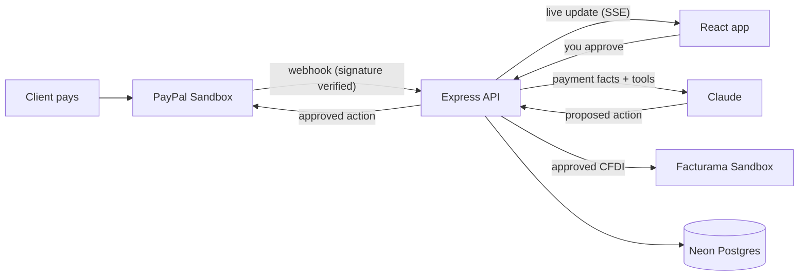

# VNV Copilot

**The AI copilot that makes the first move when you get paid.** For Mexican freelancers billing clients at home and abroad through PayPal. It reads your money freely, proposes the next step, and never acts until you approve.

**[Try the live demo](https://vnv-copilot.onrender.com)** · Built by [VNV-Tech](https://github.com/VNV-Tech) for the [PayPal AI Hackathon](https://paypalaihackathon.devpost.com/)

> PayPal and Facturama run in **sandbox only**: no real money and no legally valid tax documents. The demo is public, so please use test data only.

## The problem

Getting paid is not the end of a freelancer's job. It is the start of a to-do list that nobody reminds you about: set money aside for taxes, chase the clients who haven't paid, and issue the tax invoice your client needs.

In Mexico that last step means a **CFDI**, an invoice stamped under the rules of the tax authority (SAT). Most tools wait for you to remember all of this. VNV Copilot doesn't.

## How it works

A client in Texas pays your **$1,000 USD** invoice:

1. **PayPal notifies the app** through a webhook, and the invoice turns to *Paid* on its own, with no refresh.
2. **The copilot speaks first.** It looks at the payment and suggests what comes next, such as setting part of it aside for taxes.
3. **You stay in control.** Proposals arrive as approval cards, and nothing changes until you press *Approve*.

Your client in Texas doesn't need a Mexican tax invoice, but you may need to issue one to report the income. The copilot can prepare it in USD at the day's exchange rate. You choose the VAT rate, because that depends on the service you provide.

If your client is in Monterrey and pays in pesos, the copilot collects their tax details and issues the CFDI for them, again only after your approval.

## Features

### Business mode: get paid
- **AI copilot chat:** ask about your income or tell it what to bill, in English or Spanish.
- **PayPal invoices in USD or MXN:** create, send, remind and cancel, from the chat or the Invoices page.
- **Live updates:** invoice status changes as soon as the client pays.
- **CFDI 4.0 for clients abroad (USD):** nothing for your client to fill in. You choose the VAT rate and their country, and the app adds the exchange rate. You issue it to report the income and keep the stamped PDF and XML.
- **CFDI 4.0 for clients in Mexico (MXN):** your client fills in a Spanish form once through a private link, and the app remembers their details for future invoices. You approve, and it's stamped and emailed to them.

### Personal mode: keep what you earn
- **Savings buckets:** when you get paid, the app proposes how much to set aside for each goal, such as taxes. The buckets are virtual; no money moves.
- **Review all with AI:** several payments waiting? One ticket lists them all with checkboxes and the AI's recommendation, and you approve once.
- **Payment history:** ask *"When did Test Buyer pay me?"* and get the date, transaction ID and what you set aside.

### For first-time users
- **Guided tour:** a 14-step walkthrough on the first visit.

## The AI never acts alone

This is the core design rule, and the server enforces it, not just the prompt. Tools that change something are not executed when the model calls them: they become approval cards, and they only run when the user approves.

| The copilot can do this on its own | The copilot needs your approval |
| --- | --- |
| List and read invoices | Create, send, remind or cancel an invoice |
| Look up payment history | Accept a set-aside proposal |
| Read your savings | Change your savings plan |
| Get a client's tax-details link | Save a client's tax details |
| | Issue a CFDI |

See `ACTION_TOOLS` in [`server/src/ai/tools.ts`](server/src/ai/tools.ts).

## Try the demo

Open **<https://vnv-copilot.onrender.com>**. It runs on a free plan, so the first load can take up to a minute.

1. Follow the guided tour.
2. In the **Copilot**, ask *"Who owes me money?"* or *"¿Cuánto cobré este mes?"*
3. Ask it to create an invoice, for example *"Invoice Test Client at client@example.com for 200 USD for a logo, due in 15 days"*, and see the approval card.
4. Switch to **Personal** mode, open **Savings** and press **Review all with AI** (it appears when two or more payments are waiting).

There is no login, so everyone shares one sandbox account.

## How it's built



| Layer | Tech |
| --- | --- |
| Frontend | React 19, TypeScript, Vite, Tailwind CSS 4, React Router |
| Backend | Node.js, Express 5, TypeScript, Zod |
| AI | Claude Sonnet 5.5 (Anthropic API) with tool use and prompt caching |
| Tax invoices | Facturama Sandbox (CFDI 4.0), exchange rate from Banxico or an ECB reference |
| Data | Neon Postgres in the demo, local JSON files in development |
| Hosting | Render |

### PayPal integration

| PayPal product | What we use it for | Where |
| --- | --- | --- |
| **Invoicing API v2** | Create, send, remind, cancel and track invoices | [`server/src/paypal/invoices.ts`](server/src/paypal/invoices.ts) |
| **Transaction Search**, through the official [`@paypal/paypal-server-sdk`](https://www.npmjs.com/package/@paypal/paypal-server-sdk) | Income, payments to review, and payment history | [`server/src/paypal/transactions.ts`](server/src/paypal/transactions.ts) |
| **Webhooks** | Update the app and trigger the copilot when a client pays | [`server/src/routes/webhooks.ts`](server/src/routes/webhooks.ts) |

## Known limitations

We would rather be clear about this than oversell it:

- **The CFDI flow is a demonstration.** It follows the real CFDI 4.0 format and is stamped by Facturama's sandbox with SAT test data, but it has no legal validity and **a tax professional has not reviewed it**.
- **It covers the simple case only:** VAT included in the price, no withholdings, one generic product code, and paid in full.
- **The app doesn't decide your taxes.** On USD invoices you choose 0% or 16% VAT. A client abroad doesn't guarantee 0%: it depends on the service, and whether a payment through PayPal qualifies needs professional review.
- **USD is treated as a client abroad,** so a Mexican client paying in USD isn't covered.
- **It's a single-user demo:** no accounts or login, and chats are reset when the server restarts.

## What's next

- Withholdings and more tax scenarios, reviewed by a tax professional.
- Accounts, so each freelancer has their own PayPal connection and tax certificates.
- Other countries, by plugging in e-invoicing providers with each country's rules.

## Run it locally

You'll need:

- Node.js **20.19+**
- A [PayPal Developer](https://developer.paypal.com) Sandbox app
- An [Anthropic API key](https://console.anthropic.com)
- Optional: a [Facturama sandbox](https://dev.facturama.mx) account (without it, only CFDI issuing is turned off)
- Optional: a free [Banxico token](https://www.banxico.org.mx/SieAPIRest/service/v1/token) for the official exchange rate (without it, USD CFDIs use an ECB reference rate)

```bash
git clone https://github.com/VNV-Tech/PayPal-AI-Hackathon.git
cd PayPal-AI-Hackathon
npm ci
cp .env.example .env   # then fill in your keys
npm run dev
```

- App: <http://localhost:5173>
- API: <http://localhost:3000/api/health>

**Webhooks:** PayPal needs a public HTTPS URL, so use [Cloudflare Tunnel](https://developers.cloudflare.com/cloudflare-one/connections/connect-networks/do-more-with-tunnels/trycloudflare/). In a second terminal:

```bash
npm run tunnel                                        # prints https://<random>.trycloudflare.com
npm run paypal:webhook -- https://<random>.trycloudflare.com   # registers it and saves the ID in .env
```

The URL changes every time, so repeat this each time you start the tunnel. Close the tunnel when you finish, because your local app is reachable from the internet while it runs.

**Production build:**

```bash
npm run build
NODE_ENV=production npm start   # Express serves the API and the React build on PORT
```

## Project structure

```
client/   React app (pages, chat, tour, modes)
server/
  src/ai/       Copilot, its tools, and the proactive first move
  src/paypal/   Invoicing, Transaction Search, overview
  src/          Tax info and CFDI, savings, data storage
docs/     Team handbook and daily log (in Spanish)
```

## Security

- **Sandbox only:** the server won't start unless `PAYPAL_ENV=sandbox`; there is no way to point it at live PayPal.
- **Secrets** stay in environment variables and are never sent to the browser.
- **Webhook signatures** are verified, and unverified events are dropped.
- **Abuse limits:** rate limiting, a daily cap on AI calls, request size limits, input validation with Zod, and Helmet security headers.

## Team

- **Víctor:** tech lead
- **Vanessa:** creative direction
- **Natalia:** strategy, story and pitch

## License

[MIT](LICENSE)
