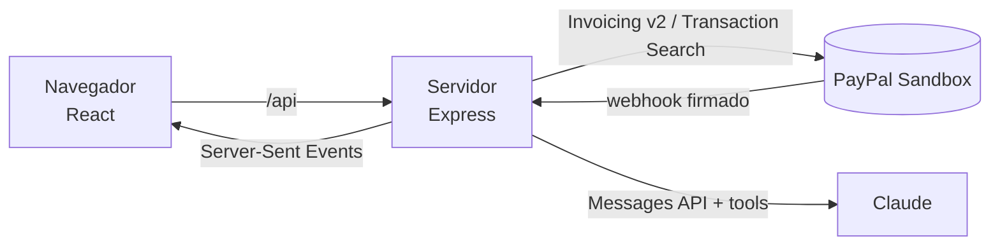

# VNV Copilot: el libro del proyecto

> Documento vivo del equipo. Explica **qué estamos haciendo, por qué, cómo funciona y qué falta**, y sobre todo **qué se puede cambiar del diseño**.
> Cada tema va dos veces: primero simple (🍎) y luego técnico (🔧), para que cualquiera del equipo lo entienda.
>
> Última actualización: 27 de octubre de 2026 (tutorial de bienvenida).

## Índice

1. [Qué es y por qué lo hacemos](#1-qué-es-y-por-qué-lo-hacemos)
2. [Cómo funciona por dentro](#2-cómo-funciona-por-dentro)
3. [Las pantallas, una por una](#3-las-pantallas-una-por-una)
4. [Diseño: qué se puede cambiar y qué no](#4-diseño-qué-se-puede-cambiar-y-qué-no)
5. [Problemas de diseño que ya conocemos](#5-problemas-de-diseño-que-ya-conocemos)
6. [Qué falta por hacer](#6-qué-falta-por-hacer)
7. [Lo que ya se hizo](#7-lo-que-ya-se-hizo)
8. [Glosario](#8-glosario)

---

## 1. Qué es y por qué lo hacemos

### 🍎 En simple

**VNV Copilot es un asistente de dinero para freelancers**: personas que cobran por su cuenta, como diseñadoras, programadores o fotógrafos.

Con la app puedes:
- **Cobrar:** crear facturas que el cliente paga con PayPal o con tarjeta.
- **Saber cómo vas:** cuánto te deben, cuánto cobraste este mes y quién ya se pasó de la fecha de pago.
- **Platicar con una IA** que hace todo eso por ti. La regla de oro: **la IA nunca hace nada sin que tú lo apruebes.**
- **Apartar dinero:** cada vez que te pagan, la app te pregunta si quieres guardar una parte, por ejemplo para impuestos.
- **Aprender a usarla en un minuto:** la primera vez, un tutorial con el copiloto te enseña cada pantalla.

### Por qué

Es para el **PayPal AI Hackathon**. Se entrega el **12 de noviembre de 2026** (14:00 hora de CDMX) y el jurado lo revisa del 1 al 15 de diciembre.

El jurado califica 5 cosas, **todas valen lo mismo**:

| Criterio | Qué significa para nosotros |
|---|---|
| Implementación técnica | Que funcione de verdad con PayPal y con la IA |
| **Diseño** | **Que se vea bien y se entienda sin explicación** ← aquí entra Vanessa |
| Impacto | Que resuelva un problema real de freelancers |
| Innovación | Que la IA haga algo útil y nuevo |
| Presentación | El video, el README y el Devpost |

El premio al que apuntamos es **"Best Use of PayPal + AI"**.

### 🔧 En técnico

- **Frontend:** React 19 + TypeScript + Vite + Tailwind CSS 4 + React Router (carpeta `client/`).
- **Backend:** Node.js + Express 5 + TypeScript + zod (carpeta `server/`).
- **PayPal:** API REST de Invoicing v2 y Transaction Search (esta última con el SDK oficial `@paypal/paypal-server-sdk`, hecho por APIMatic), además de webhooks. **Solo Sandbox**: está bloqueado en el código para que nunca se use dinero real.
- **IA:** Claude (Anthropic) con *tool use*. La IA puede **leer** datos sola, pero cada **acción** se convierte en una propuesta que el usuario aprueba.

---

## 2. Cómo funciona por dentro

### 🍎 En simple

Piensa en un restaurante:

- **La pantalla (frontend)** es el **comedor**: lo que ve el cliente.
- **El servidor (backend)** es la **cocina**: ahí se hace el trabajo y se guardan los secretos (las llaves de PayPal y de la IA).
- **PayPal** es el **banco**: guarda las facturas y el dinero de prueba.
- **Claude (la IA)** es un **mesero muy listo**: entiende lo que pides, revisa en la cocina y te propone qué hacer. Pero **no sirve nada hasta que tú dices "sí"**.
- **Los webhooks** son el **timbre**: cuando un cliente paga, PayPal toca el timbre y la pantalla se actualiza sola.

### 🔧 En técnico



| Pieza | Archivo principal | Qué hace |
|---|---|---|
| Conexión con PayPal | `server/src/paypal/client.ts` | Pide y guarda el token de acceso; reintenta si PayPal falla |
| Facturas | `server/src/paypal/invoices.ts` | Crear, listar, enviar, recordar, cancelar y borrar |
| Pagos del mes | `server/src/paypal/transactions.ts` | Busca pagos recibidos con el SDK oficial |
| Resumen | `server/src/paypal/overview.ts` | Calcula los números de Inicio |
| Apartados | `server/src/savings.ts` | Plan de ahorro y respuestas a "¿apartas de este pago?" |
| Copiloto | `server/src/ai/copilot.ts` y `tools.ts` | Conversación con Claude y la pausa para aprobar |
| Webhooks | `server/src/routes/webhooks.ts` | Recibe el aviso de PayPal y verifica que sea auténtico |
| Avisos en vivo | `server/src/events.ts` | Reenvía esos avisos a las pantallas abiertas |

**Cosas importantes que hay que saber:**

- **No hay base de datos.** Las facturas se leen siempre directo de PayPal. Las conversaciones del chat viven en memoria y se borran al reiniciar el servidor. El plan de ahorro se guarda en un archivo (`server/data/savings.json`). Para la demo basta así.
- **No hay login.** Cualquiera con el link puede usar la demo; es a propósito para que el jurado entre fácil. Por eso hay límites de uso (por ejemplo, 20 acciones por minuto).
- **Solo Sandbox.** El servidor no arranca si alguien intenta usar PayPal real.

### Los 4 flujos principales

**1. Crear y cobrar una factura**
1. El usuario llena el formulario en Invoices (o se lo pide al chat).
2. Se crea como **borrador** en PayPal. Todavía no se le manda nada al cliente.
3. El usuario presiona **Send** y PayPal le manda un correo al cliente con el link de pago.
4. El cliente paga y PayPal toca el timbre (webhook). La factura cambia a **Paid** sola.

**2. El chat con aprobación**
1. El usuario escribe, por ejemplo: "cóbrale 500 a Ana".
2. Claude lee los datos que necesita sin pedir permiso, porque solo está leyendo.
3. Para **hacer** algo (crear, enviar, cancelar, apartar), Claude solo **propone**: aparece una tarjeta con **Approve / Reject**.
4. Solo si el usuario aprueba, el servidor lo hace de verdad, y el resultado vuelve a Claude.

**3. Todo se actualiza solo**
Cuando llega un webhook verificado, el servidor avisa a las pantallas abiertas (Server-Sent Events) y estas vuelven a pedir sus datos. En Invoices sale el mensaje: *"Invoice #0005 was just paid 🎉"*.

**4. Apartados de ahorro**
Cada pago del mes aparece en Savings con la pregunta: *"You got paid $500. Set aside $100 for Taxes and $50 for Emergency fund?"*. Solo cuenta lo que el usuario acepta. **No se mueve dinero en PayPal**: es una cuenta para saber cuánto de lo cobrado no es para gastar.

---

## 3. Las pantallas, una por una

> Todos los textos de la app están en **inglés**, porque el jurado es internacional.

### Barra de arriba (en todas las pantallas)
- **Archivo:** `client/src/components/Layout.tsx`
- **Qué tiene:** logo y nombre ("VNV Copilot"), menú (Overview, Copilot, Invoices, Savings), el botón **Tour** y la etiqueta **Sandbox**.
- El nombre de la app se cambia en un solo lugar: `client/src/lib/config.ts` (`APP_NAME`).

### Tutorial de bienvenida
- **Archivos:** los textos en `client/src/lib/tour.ts`; cómo se ve, en `client/src/components/Tour.tsx`.
- **Para qué:** que alguien que entra por primera vez entienda la app sin explicación.
- **Cómo funciona:** sale solo la primera vez (el navegador lo recuerda). Oscurece la pantalla, ilumina una parte y el copiloto explica qué es, en 6 pasos: bienvenida → Inicio → Facturas → Savings → Chat → listo.
- Botones **Next**, **Back** y **Skip tour**. Con el teclado: flechas para avanzar o regresar, y `Esc` para salir.
- Se vuelve a ver con el botón **Tour** de la barra de arriba.
- **No usa la IA ni gasta créditos:** todos los mensajes están escritos a mano.

### Overview (Inicio)
- **Archivo:** `client/src/pages/Overview.tsx`
- **Para qué:** ver de un vistazo cómo vas.
- **Qué tiene:**
  - 3 tarjetas: **Outstanding** (cuánto te deben), **Paid this month** (cuánto cobraste), **Overdue** (facturas vencidas).
  - Un recuadro "Try saying" con ejemplos de qué pedirle al chat.
  - Botones **Refresh** y **Ask the copilot**.
- **Estados:** cargando (muestra "…"), error (franja roja con "Try again").

### Copilot (el chat)
- **Archivo:** `client/src/pages/Copilot.tsx`
- **Para qué:** pedir cosas en lenguaje normal.
- **Qué tiene:**
  - Burbujas de conversación: las del usuario en azul a la derecha y las de la IA a la izquierda.
  - Sugerencias en forma de botones al inicio.
  - "Thinking…" mientras la IA piensa.
  - **Tarjetas de acción** con los detalles y los botones **Approve / Reject**.
  - Botón **New chat**.
- **Estados de una tarjeta:** pendiente, ejecutándose, aprobada, rechazada, falló.

### Invoices (Facturas)
- **Archivo:** `client/src/pages/Invoices.tsx`
- **Para qué:** ver y manejar todas las facturas.
- **Qué tiene:**
  - Tabla con número, cliente, monto, fecha de vencimiento, estado (etiqueta de color) y acciones.
  - Botón **New invoice**, que abre un formulario en una ventana.
  - Antes de enviar, recordar, cancelar o borrar, sale una ventana de confirmación.
  - Mensaje verde cuando algo sale bien (por ejemplo, "Invoice sent").
- **Estados de factura que ve el usuario:** Draft, Sent, Overdue, Scheduled, Payment pending, Partially paid, Paid, Cancelled, Refunded.

### Savings (Apartados)
- **Archivo:** `client/src/pages/Savings.tsx`
- **Para qué:** decidir cuánto de lo cobrado guardar.
- **Qué tiene:**
  - Tarjetas "**You got paid…** Set aside…?" con **Set aside** / **Not this time**.
  - **Collected** (cobrado del mes) y **Left to spend** (lo que queda para gastar).
  - Una tarjeta por apartado con lo que llevas guardado.
  - Botón **Edit plan**, que abre una ventana para cambiar nombres y porcentajes (hasta 6 apartados, máximo 100%).

---

## 4. Diseño: qué se puede cambiar y qué no

### Lo más importante

**Vanessa tiene la dirección creativa al 100%.** Ella decide qué se ve, cómo se ve, qué se agrega, qué se queda y qué se quita.

Lo único que cambia es **quién lo hace**:
- 🟢 Lo que es **solo visual** lo puede cambiar ella directo.
- 🟡 y 🔴 Si quiere cambiar algo que **también cambia cómo funciona la app**, ella decide **qué** quiere y Víctor (con Claude) se encarga de **cómo** programarlo. Basta con que lo describa con palabras o una captura de Figma.

> 🍎 Ella es la arquitecta: decide cómo es la casa. Si quiere mover una pared, lo dice; Víctor se encarga de que no se caiga el techo.

### 🟢 Verde: cámbialo con toda libertad

Esto es solo visual. Si algo sale mal, se regresa con un clic.

| Qué | Dónde | Ejemplo |
|---|---|---|
| **Colores** de toda la app | `client/src/index.css` (dentro de `@theme`) | Cambiar el azul de marca por otro |
| **Tipografía** | `client/src/index.css` (`--font-sans`) y `client/index.html` para cargar la fuente | Usar otra letra |
| **Botones, tarjetas, etiquetas, ventanas** (todos a la vez) | `client/src/components/ui.tsx` | Botones cuadrados en lugar de redondos |
| **Acomodo de cada pantalla**: orden, tamaños, espacios, columnas | `client/src/pages/*.tsx` | Poner Savings en dos columnas |
| **Barra de arriba y menú** | `client/src/components/Layout.tsx` | Menú lateral en lugar de barra |
| **Textos de la interfaz**: títulos, descripciones, botones, mensajes (en inglés) | En cada pantalla | "Outstanding" → "Owed to you" |
| **Nombre de la app** | `client/src/lib/config.ts` (`APP_NAME`) | Otro nombre |
| **Logo / ícono** | `client/public/favicon.svg` y `Layout.tsx` | Un logo nuevo |
| **Íconos, ilustraciones, imágenes** | Nuevas, en `client/public/` | Ilustración para pantallas vacías |
| **Pantallas vacías, de carga y de error** | En cada pantalla | Un dibujo cuando no hay facturas |
| **Los ejemplos** de "Try saying" y las sugerencias del chat | `Overview.tsx` y `Copilot.tsx` (`suggestions`) | Ejemplos nuevos |
| **El tutorial**: textos, orden, cuántos pasos, cómo se ve | Textos en `client/src/lib/tour.ts`, aspecto en `client/src/components/Tour.tsx` | Otro tono, otro personaje, más o menos pasos |
| **Modo oscuro**, animaciones, transiciones | `index.css` y componentes | Agregar modo oscuro |
| **Versión para celular** | Todas las pantallas | Menú hamburguesa |

### 🟡 Amarillo: se puede, pero avísale a Víctor primero

Se ve como diseño, pero está conectado con cómo funciona la app.

| Qué | Por qué hay que avisar |
|---|---|
| **Los campos del formulario de factura** (agregar, quitar u obligar campos) | PayPal y el servidor esperan ciertos datos: nombre, correo, conceptos, moneda, plazo |
| **Quitar o mover botones de acción** (Send, Remind, Cancel, Delete, Set aside, Approve) | Cada uno hace algo real en PayPal o en los apartados |
| **Cambiar los nombres de los estados** (Paid, Overdue…) | Se puede: los textos están en `client/src/lib/invoices.ts` (`displayStatus`). Pero cada estado tiene que seguir siendo distinto de los demás |
| **Agregar una pantalla o sección nueva con datos** | Si muestra datos nuevos, hay que programarlos en el servidor |
| **Qué parte ilumina cada paso del tutorial** | Cada `target` en `tour.ts` debe coincidir con un `data-tour="..."` en la pantalla; si se borra ese `data-tour`, el paso sale al centro sin iluminar nada |
| **Lo que dice la IA y cómo habla** | Vive en el servidor (`server/src/ai/copilot.ts`), no en la pantalla |
| **Las monedas** (MXN, USD) y los plazos de pago | Están ligados a lo que acepta PayPal |
| **Cualquier cosa en `client/src/lib/`** | Ahí está la conexión con el servidor, no el diseño |

### 🔴 Rojo: no se toca (salvo que el equipo lo decida junto)

Son reglas del proyecto, no gustos.

| Qué | Por qué |
|---|---|
| **Que la IA pida aprobación** (tarjetas Approve / Reject) | Es la idea central del proyecto y lo que más le importa al jurado: la IA nunca actúa sola. Se puede rediseñar cómo se ve, pero no quitar |
| **La confirmación antes de enviar, cancelar o borrar** | Evita errores con clientes reales |
| **La etiqueta "Sandbox"** (o algo equivalente) | Deja claro que es una demo con dinero de prueba |
| **Que todo sea Sandbox** | Ni por error se usa PayPal real |
| **La carpeta `server/`** y el archivo **`.env`** | Ahí están la lógica y las llaves secretas |
| **Pedir datos personales reales** | La demo es pública |

### 🔧 Cómo leer el código de diseño (Tailwind en 2 minutos)

Los estilos se escriben como palabras dentro de `className`. Ejemplo real de una tarjeta:

```tsx
<section className="rounded-2xl border border-line bg-surface p-6 shadow-sm">
```

| Palabra | Qué hace |
|---|---|
| `rounded-2xl` | Esquinas redondeadas de 16 px |
| `border` | Borde de 1 px |
| `border-line` | El borde usa el color `line` |
| `bg-surface` | Fondo con el color `surface` |
| `p-6` | Relleno interior de 24 px (cada número equivale a 4 px: `p-4` = 16 px) |
| `shadow-sm` | Sombra pequeña |
| `text-sm` / `text-2xl` | Tamaño de letra chico / grande |
| `font-bold` | Negritas |
| `flex` / `grid` / `gap-4` | Acomodar en fila o en cuadrícula, con 16 px de separación |
| `sm:grid-cols-3` | En pantallas medianas o más grandes, 3 columnas (en celular, una) |

Los colores se usan por **nombre**, no por código. Si en `index.css` cambias `--color-brand-600`, cambian todos los `bg-brand-600`, `text-brand-600`, etc.

**Colores actuales** (`client/src/index.css`):

| Nombre | Color | Dónde se usa |
|---|---|---|
| `brand-900` | `#001c64` | Títulos sobre fondo azul claro |
| `brand-800` | `#003087` | Barra de arriba |
| `brand-600` | `#0070e0` | Botones principales, enlaces |
| `brand-500` | `#1a85ff` | Detalles |
| `brand-100` | `#e6f0fd` | Fondos suaves, etiquetas "info" |
| `brand-50` | `#f2f7fe` | Recuadros destacados |
| `canvas` | `#f5f7fa` | Fondo general |
| `surface` | `#ffffff` | Tarjetas |
| `line` | `#e3e7ed` | Bordes |
| `ink` | `#001435` | Texto principal |
| `ink-muted` | `#545d68` | Texto secundario (gris) |
| `success` / `success-bg` | `#017a3f` / `#e6f4ec` | Pagado, mensajes de éxito |
| `warning` / `warning-bg` | `#a35d00` / `#fff4e0` | Pendiente |
| `danger` / `danger-bg` | `#c4002b` / `#fde8ec` | Vencido, errores |

**De Figma al código:** si en Figma los colores, tamaños de letra y espaciados tienen **nombre** (por ejemplo "Primary / 600" o "Spacing / 24"), pasarlos al código es casi directo. Mientras más consistente sea Figma, más rápido se programa.

---

## 5. Problemas de diseño que ya conocemos

Hoy la página **funciona, pero es poco intuitiva**. Esta es una lista honesta para empezar. Vanessa decide cuáles se arreglan y cómo.

**Generales**
- **Explica poco qué es la app.** Ya hay un tutorial de bienvenida (primera versión), pero las pantallas por sí solas todavía no se explican.
- **No está pensada para celular.** El menú de arriba no se acomoda en pantallas chicas.
- **La tipografía no se carga:** el código pide **Inter**, pero no se descarga, así que se ve la letra del sistema.
- **No hay identidad propia:** el nombre es provisional, el logo es una "V" sencilla y los colores son de ejemplo, inspirados en PayPal.
- **Sin modo oscuro.**
- **No hay íconos:** todo es texto.

**Overview**
- Son solo 3 números sin contexto: no se ve si vas mejor o peor que antes, ni qué hacer después.
- Los ejemplos de "Try saying" **no se pueden presionar**, y uno menciona la factura #0007, que no existe.

**Copilot**
- No queda claro qué puede y qué no puede hacer la IA.
- Las tarjetas de aprobación son pequeñas y se parecen mucho entre sí; podrían destacar más qué va a pasar.
- Si la IA falla, solo sale un texto rojo.

**Invoices**
- No hay pantalla de detalle de una factura: solo la tabla.
- Para ver o pagar una factura, el link lleva a PayPal.
- La tabla en celular se desliza de lado.

**Savings**
- **El concepto confunde.** En las pruebas, Víctor pensó que la app había apartado dinero de verdad sin preguntarle. Hay que dejar muy claro que es una cuenta "de mentira" y que no se mueve dinero.
- Los porcentajes de ejemplo (Taxes 20%, Emergency fund 10%) aparecen desde el inicio sin explicar de dónde salen.
- "Set aside" y "Not this time" podrían explicarse mejor.

---

## 6. Qué falta por hacer

### Del plan original

| # | Tarea | Fecha planeada | Responsable | Estado |
|---|---|---|---|---|
| 1 | Facturas con PayPal | — | Víctor | ✅ Hecho |
| 2 | Chat con IA que pide aprobación | — | Víctor | ✅ Hecho |
| 3 | Webhooks: todo se actualiza solo | 3–4 nov | Víctor | ✅ Hecho (adelantado) |
| 4 | Modo personal (apartados) | 5–7 nov | Víctor | ✅ Hecho (adelantado) |
| 5 | **Rediseño de la app** | Antes del video | **Vanessa** | ⏳ Por empezar |
| 5b | Tutorial de bienvenida (primera versión) | — | Víctor | ✅ Hecho; Vanessa decide textos y aspecto |
| 6 | Publicar en Render | 8–9 nov | Víctor | ⏳ Falta la cuenta en render.com |
| 7 | README en inglés, video de menos de 3 min, Devpost | 10–12 nov | Natalia + Víctor | ⏳ Pendiente |
| 8 | Pasar todo a `main` (lo que ve el jurado) | Antes de entregar | Víctor | ⏳ Pendiente |

### Preguntas abiertas para la asesoría

**Finanzas**
- ¿Qué porcentajes tienen sentido para un freelancer en México? (impuestos, emergencias, otros)
- ¿Los apartados deben reiniciarse cada mes o acumularse?
- ¿Qué más le serviría a un freelancer ver en Inicio?

**Diseño** (decide Vanessa)
- ¿Cómo se explica la app la primera vez que alguien entra?
- ¿Qué se queda, qué se va y qué falta en cada pantalla?
- ¿Nombre final, logo y colores?

### Ideas guardadas para después (si sobra tiempo)
- Que los ejemplos de "Try saying" se puedan presionar.
- Autofacturación del SAT (CFDI) con Facturapi: investigado, **en pausa** hasta que el equipo decida.
- Base de datos para que nada se pierda al reiniciar.
- Login real, si el proyecto sigue después del hackathon.

---

## 7. Lo que ya se hizo

Cada cambio entró con un **Pull Request** (PR) a `dev`, aprobado por Víctor.

| PR | Qué se agregó |
|---|---|
| #1–#5 | Estructura del proyecto, ramas del equipo, guía del equipo, servidor y conexión segura con PayPal |
| #6 | Candado: solo Sandbox, nunca dinero real |
| #7 | Facturas de PayPal y pantalla Invoices |
| #8 | Chat con IA que pide aprobación para cada acción |
| #9 | Revisión de seguridad: límites de uso y mejores mensajes de error de PayPal |
| #10 | Números reales en Inicio y primer uso del SDK oficial de PayPal (APIMatic) |
| #11 | Webhooks: facturas y números se actualizan solos cuando alguien paga |
| #12 | Modo personal: apartados que preguntan con cada pago, también desde el chat |
| #13 | Corrección de los papeles del equipo en la documentación |
| #14 | Este documento |
| #15 | Tutorial de bienvenida con el copiloto (sin IA, no gasta créditos) |

Para el detalle de la configuración inicial (ramas, candados, plugin de PayPal), ver [`guia-lo-que-se-hizo.md`](guia-lo-que-se-hizo.md).

---

## 8. Glosario

| Palabra | 🍎 En simple | 🔧 En técnico |
|---|---|---|
| Frontend | Lo que ves en el navegador | `client/`: React + Vite |
| Backend / servidor | La cocina: hace el trabajo y guarda secretos | `server/`: Express + Node |
| API | La ventanilla para pedirle cosas a otro sistema | Peticiones HTTP con JSON |
| Sandbox | El PayPal de mentira para probar | `api-m.sandbox.paypal.com` |
| Webhook | El timbre: PayPal avisa cuando pasa algo | `POST /webhooks/paypal` con firma verificada |
| Token | Un pase temporal para hablar con PayPal | OAuth 2.0 *client credentials*, dura horas |
| `.env` | El archivo secreto con las llaves | Variables de entorno, nunca se sube a git |
| Rama | Tu copia de trabajo | `git branch`: `victor`, `vanessa`, `natalia` |
| Commit | Guardar una versión con una nota | Una "foto" del código en git |
| Pull Request (PR) | Pedir que junten tus cambios | Revisión y *merge* en GitHub |
| `dev` / `main` | Donde se junta todo / lo que ve el jurado | Ramas protegidas, solo con PR |
| Tool use | La IA usando "herramientas" para leer o proponer | `tools` de la Messages API de Claude |
| SSE | Línea abierta para avisos en vivo | Server-Sent Events, `GET /api/events` |
| Token de diseño | Un color o tamaño con nombre | Variables `@theme` en `index.css` |
| Tour / onboarding | El tutorial de la primera vez | `Tour.tsx` + `tour.ts`, recuerda en `localStorage` si ya se vio |
