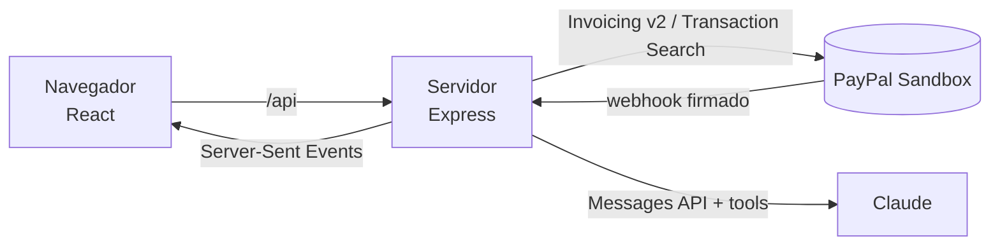

# VNV Copilot: el libro del proyecto

> Documento vivo del equipo. Explica **qué estamos haciendo, por qué, cómo funciona y qué falta**, y sobre todo **qué se puede cambiar del diseño**.
> Cada tema va dos veces: primero simple (🍎) y luego técnico (🔧), para que cualquiera del equipo lo entienda.
>
> Última actualización: 27 de octubre de 2026 (tutorial de bienvenida).

## Índice

1. [Qué es y por qué lo hacemos](#1-qué-es-y-por-qué-lo-hacemos)
2. [Cómo funciona por dentro](#2-cómo-funciona-por-dentro)
3. [Las pantallas, una por una](#3-las-pantallas-una-por-una)
4. [Diseño: qué se puede cambiar y qué no](#4-diseño-qué-se-puede-cambiar-y-qué-no)
5. [Problemas de diseño que ya conocemos](#5-problemas-de-diseño-que-ya-conocemos)
6. [Qué falta por hacer](#6-qué-falta-por-hacer)
7. [Lo que ya se hizo](#7-lo-que-ya-se-hizo)
8. [Glosario](#8-glosario)

---

## 1. Qué es y por qué lo hacemos

### 🍎 En simple

**VNV Copilot es un asistente de dinero para freelancers**: personas que cobran por su cuenta, como diseñadoras, programadores o fotógrafos.

Con la app puedes:
- **Cobrar:** crear facturas que el cliente paga con PayPal o con tarjeta.
- **Saber cómo vas:** cuánto te deben, cuánto cobraste este mes y quién ya se pasó de la fecha de pago.
- **Platicar con una IA** que hace todo eso por ti. La regla de oro: **la IA nunca hace nada sin que tú lo apruebes.**
- **Apartar dinero:** cada vez que te pagan, la app te pregunta si quieres guardar una parte, por ejemplo para impuestos.
- **Aprender a usarla en un minuto:** la primera vez, un tutorial con el copiloto te enseña cada pantalla.

### Por qué

Es para el **PayPal AI Hackathon**. Se entrega el **12 de noviembre de 2026** (14:00 hora de CDMX) y el jurado lo revisa del 1 al 15 de diciembre.

El jurado califica 5 cosas, **todas valen lo mismo**:

| Criterio | Qué significa para nosotros |
|---|---|
| Implementación técnica | Que funcione de verdad con PayPal y con la IA |
| **Diseño** | **Que se vea bien y se entienda sin explicación** ← aquí entra Vanessa |
| Impacto | Que resuelva un problema real de freelancers |
| Innovación | Que la IA haga algo útil y nuevo |
| Presentación | El video, el README y el Devpost |

El premio al que apuntamos es **"Best Use of PayPal + AI"**.

### 🔧 En técnico

- **Frontend:** React 19 + TypeScript + Vite + Tailwind CSS 4 + React Router (carpeta `client/`).
- **Backend:** Node.js + Express 5 + TypeScript + zod (carpeta `server/`).
- **PayPal:** API REST de Invoicing v2 y Transaction Search (esta última con el SDK oficial `@paypal/paypal-server-sdk`, hecho por APIMatic), además de webhooks. **Solo Sandbox**: está bloqueado en el código para que nunca se use dinero real.
- **IA:** Claude (Anthropic) con *tool use*. La IA puede **leer** datos sola, pero cada **acción** se convierte en una propuesta que el usuario aprueba. Modelo: **Sonnet 5.5** (`ANTHROPIC_MODEL`), con caché de prompts: cada mensaje cuesta alrededor de 1 centavo de dólar, así que los ~$10 de créditos alcanzan para la revisión del jurado. El servidor anota los tokens de cada llamada en el log (`[claude] ...`).

---

## 2. Cómo funciona por dentro

### 🍎 En simple

Piensa en un restaurante:

- **La pantalla (frontend)** es el **comedor**: lo que ve el cliente.
- **El servidor (backend)** es la **cocina**: ahí se hace el trabajo y se guardan los secretos (las llaves de PayPal y de la IA).
- **PayPal** es el **banco**: guarda las facturas y el dinero de prueba.
- **Claude (la IA)** es un **mesero muy listo**: entiende lo que pides, revisa en la cocina y te propone qué hacer. Pero **no sirve nada hasta que tú dices "sí"**.
- **Los webhooks** son el **timbre**: cuando un cliente paga, PayPal toca el timbre y la pantalla se actualiza sola.

### 🔧 En técnico



| Pieza | Archivo principal | Qué hace |
|---|---|---|
| Conexión con PayPal | `server/src/paypal/client.ts` | Pide y guarda el token de acceso; reintenta si PayPal falla |
| Facturas | `server/src/paypal/invoices.ts` | Crear, listar, enviar, recordar, cancelar y borrar |
| Pagos del mes | `server/src/paypal/transactions.ts` | Busca pagos recibidos con el SDK oficial |
| Resumen | `server/src/paypal/overview.ts` | Calcula los números de Inicio |
| Apartados | `server/src/savings.ts` | Plan de ahorro y respuestas a "¿apartas de este pago?" |
| Copiloto | `server/src/ai/copilot.ts` y `tools.ts` | Conversación con Claude y la pausa para aprobar |
| Webhooks | `server/src/routes/webhooks.ts` | Recibe el aviso de PayPal y verifica que sea auténtico |
| Avisos en vivo | `server/src/events.ts` | Reenvía esos avisos a las pantallas abiertas |

**Cosas importantes que hay que saber:**

- **No hay base de datos.** Las facturas se leen siempre directo de PayPal. Las conversaciones del chat viven en memoria y se borran al reiniciar el servidor. El plan de ahorro se guarda en un archivo (`server/data/savings.json`). Para la demo basta así.
- **No hay login.** Cualquiera con el link puede usar la demo; es a propósito para que el jurado entre fácil. Por eso hay límites de uso (por ejemplo, 20 acciones por minuto).
- **Solo Sandbox.** El servidor no arranca si alguien intenta usar PayPal real.

### Los 4 flujos principales

**1. Crear y cobrar una factura**
1. El usuario llena el formulario en Invoices (o se lo pide al chat).
2. Se crea como **borrador** en PayPal. Todavía no se le manda nada al cliente.
3. El usuario presiona **Send** y PayPal le manda un correo al cliente con el link de pago.
4. El cliente paga y PayPal toca el timbre (webhook). La factura cambia a **Paid** sola.

**2. El chat con aprobación**
1. El usuario escribe, por ejemplo: "cóbrale 500 a Ana".
2. Claude lee los datos que necesita sin pedir permiso, porque solo está leyendo.
3. Para **hacer** algo (crear, enviar, cancelar, apartar), Claude solo **propone**: aparece una tarjeta con **Approve / Reject**.
4. Solo si el usuario aprueba, el servidor lo hace de verdad, y el resultado vuelve a Claude.

**3. Todo se actualiza solo**
Cuando llega un webhook verificado, el servidor avisa a las pantallas abiertas (Server-Sent Events) y estas vuelven a pedir sus datos. En Invoices sale el mensaje: *"Invoice #0005 was just paid 🎉"*.

**4. Apartados de ahorro**
Cada pago del mes aparece en Savings con la pregunta: *"You got paid $500. Set aside $100 for Taxes and $50 for Emergency fund?"*. Solo cuenta lo que el usuario acepta. **No se mueve dinero en PayPal**: es una cuenta para saber cuánto de lo cobrado no es para gastar.

---

## 3. Las pantallas, una por una

> Todos los textos de la app están en **inglés**, porque el jurado es internacional.

### Dos modos: Business y Personal
- **Archivos:** `client/src/lib/mode.ts` (qué pantallas tiene cada modo) y `client/src/index.css` (los colores).
- **Para qué:** no mezclar dos cosas distintas, igual que PayPal separa cuentas personales y de negocio.
  - 💼 **Business (morado):** cobrarle a tus clientes. Pantallas: Home, Invoices, Copilot.
  - 🏠 **Personal (naranja):** organizar lo que te pagan. Pantallas: Home, Savings, Copilot.
- Se cambia con el interruptor de la barra de arriba. La app recuerda el último modo que usaste.
- La base de la app (azul marino y blanco, estilo PayPal) es igual en los dos modos. Solo cambia el **color de acento**: botones, enlaces y detalles.

### Barra de arriba (en todas las pantallas)
- **Archivo:** `client/src/components/Layout.tsx`
- **Qué tiene:** logo y nombre ("VNV Copilot"), el interruptor **Business / Personal**, el menú del modo, el botón **Tour** y la etiqueta **Sandbox**.
- **En celular:** el menú se va **abajo**, con íconos, como en las apps.
- El nombre de la app se cambia en un solo lugar: `client/src/lib/config.ts` (`APP_NAME`).

### Tutorial de bienvenida
- **Archivos:** los textos en `client/src/lib/tour.ts`; cómo se ve, en `client/src/components/Tour.tsx`.
- **Para qué:** que alguien que entra por primera vez entienda la app sin explicación.
- **Cómo funciona:** sale solo la primera vez que alguien entra (el navegador lo recuerda). Oscurece la pantalla, ilumina una parte y el copiloto explica qué es. Es una **introducción detallada de toda la app en 14 pasos**, en tres partes:
  - **Business:** los dos modos → Inicio (lo cobrado) → quién te debe → crear una factura → seguir cada factura → facturas del SAT (CFDI).
  - **Personal:** lo que te queda para gastar → tu plan de apartados → apartar cada pago.
  - **El copiloto:** pregúntale con tus palabras → tú siempre apruebas → da el primer paso cuando te pagan → listo (señala el botón **Tour** para verlo de nuevo).
- Cambia de modo y de pantalla solo. Si lo que quiere iluminar no está (por ejemplo, no hay facturas todavía), el mensaje sale al centro.
- Botones **Next**, **Back** y **Skip tour**. Con el teclado: flechas para avanzar o regresar, y `Esc` para salir.
- **En celular** el mensaje ocupa todo el ancho: va abajo, o arriba si lo que ilumina está en la parte de abajo (por ejemplo, la caja del chat). Espera hasta ~10 segundos a que aparezca lo que ilumina (las facturas vienen de PayPal).
- Se vuelve a ver con el botón **Tour** de la barra de arriba.
- **No usa la IA ni gasta créditos:** todos los mensajes están escritos a mano.

### Home (Inicio)
- **Archivo:** `client/src/pages/Overview.tsx`. Tiene **dos versiones**, una por modo.
- **Para qué:** ver de un vistazo cómo vas y qué hacer después.
- **Las dos versiones tienen el mismo orden:**
  1. Una frase arriba que explica qué estás viendo.
  2. Una **tarjeta grande azul marino** con el número más importante y **botones rápidos**.
  3. Tarjetas o listas con el detalle.
  4. "**Try asking the copilot**": ejemplos que **sí se pueden presionar**. Abren el chat con el texto ya escrito, pero no lo envían solos.
- **Business:** cobrado este mes (número grande), botones "New invoice" y "Ask the copilot", **Waiting to be paid**, **Overdue** y las **últimas 5 facturas**.
- **Personal:** aviso de que los apartados son virtuales, **lo que te queda para gastar** (número grande), aviso si hay pagos por revisar, **lo apartado** este mes y los **últimos pagos** recibidos.
- **Estados:** cargando (bloques grises animados) y error (franja roja con "Try again").

### La guía: te acompaña en todo el proceso (sin IA, gratis)
- **Archivos:** las reglas y los textos en `client/src/lib/journey.ts`; cómo se ve, en `client/src/components/Guide.tsx` (tarjeta del Home y burbuja de las demás pantallas).
- **🍎 En simple:** es como un **GPS**. El tutorial te enseña la casa una vez; la guía **va contigo**: mira en qué vas y te dice el siguiente paso, en cualquier pantalla.
  - **Sigue a tu factura más reciente de principio a fin:** *"Tu borrador #13 está listo: envíalo"* → *"Enviada ✓ Ahora esperamos a que Ana pague; te aviso en cuanto llegue"* → *"¡Ana pagó! 🎉 Pídele sus datos fiscales"* → *"Emite su CFDI"*.
  - **En Home** es una tarjeta con el camino completo. **En las demás pantallas** es una **burbuja** abajo a la izquierda con el paso actual; se puede minimizar con la ✕. En el chat no sale, para no tapar la caja de texto.
  - Se actualiza **sola**: al cambiar de pantalla, al hacer algo en la app (cualquier botón que guarda o envía) y cuando PayPal avisa de un pago.
  - **"Your next step"** mientras vas aprendiendo (un paso que nunca has hecho). **"Still to do"** para lo pendiente que se te pudo olvidar.
  - **"I've got it, turn off the guide"**: si la prendiste y ya te acostumbraste, la apagas otra vez.
  - **Business:** 1. Crea una factura → 2. Envíala → 3. Cobra → 4. Pide sus datos fiscales → 5. Manda su factura (CFDI).
  - **Personal:** 1. Arma tu plan → 2. Cobra → 3. Aparta parte de un pago.
  - Cada paso se palomea solo. El paso actual explica **qué hacer, con datos reales** (*"Draft #0012 para Juan está listo: envíalo"*) y **por qué importa**.
  - **Show me** te lleva a la pantalla e **ilumina el botón exacto** que hay que presionar. Usa el mismo efecto del tutorial.
  - Si no queda nada pendiente, dice **"All caught up 🎉"**.
- **No gasta créditos:** son reglas fijas que leen datos que la app ya tiene.
- **Empieza apagada** (desde el 29 de octubre). El tutorial de bienvenida ya explica todo, y así la guía no compite con el copiloto. Quien quiera los pasos la prende en Home con *"Want step-by-step hints? Turn on the guide"*.
- **Quién habla cuándo**, para que no sea ruido: el **tutorial** enseña todo una vez (la primera vez o con el botón Tour); el **copiloto** es el único que habla mientras usas la app, cuando pasa algo importante (te pagaron); la **guía** solo si tú la prendes.
- **🔧 En técnico:** `businessJourney` sigue la factura más reciente con algo pendiente (`stageOf`: send → paid → tax-info → cfdi) y `personalJourney` el primer pago por revisar. Cada paso trae `done`, `todo`, `hint` y `showMe`. `useJourney` (en `journey.ts`) los carga en el Layout y los recarga con la ruta, con los avisos en vivo y con el evento `vnv:data-changed`, que `lib/api.ts` lanza tras cualquier POST/PUT/DELETE exitoso. Todo se comparte por el contexto del Layout (`useLayout` en `lib/mode.ts`). "Show me" abre `Tour` con un solo paso. Prendido: `localStorage` `vnv-guide-on` (sin esa clave, apagada). Los botones de cada factura tienen `data-tour="send-<id>"`, `remind-<id>`, `tax-<id>`, etc. `GET /api/tax-info` ahora también devuelve `knownClients` (correos con datos fiscales guardados).

### El copiloto da el primer paso (proactivo)
- **Archivos:** `server/src/ai/proactive.ts` (cuándo y con qué datos), `createSuggestion` en `server/src/ai/copilot.ts`, el aviso en `client/src/components/Layout.tsx` y la tarjeta "From your copilot" en `client/src/pages/Overview.tsx`.
- **🍎 En simple:** antes, la IA solo trabajaba si tú le escribías. Ahora, **cuando un cliente te paga**, el copiloto se da cuenta solo y te prepara lo que sigue:
  - *"Juan te pagó $1,000, que incluyen $137.93 de IVA. Ya tengo sus datos fiscales: ¿emito su factura? ¿Aparto $300 para impuestos?"*
  - Te sale un aviso abajo a la derecha, **"Your copilot has a suggestion"**, y una tarjeta en Home. Con **Review** se abre en el chat con las tarjetas para aprobar.
- **Nunca hace nada solo:** sigue pidiendo tu aprobación para todo. La diferencia es que él da el primer paso.
- **🔧 En técnico:**
  - El webhook `INVOICING.INVOICE.PAID` llama a `onInvoicePaid`, que **no bloquea** la respuesta a PayPal.
  - `paidInvoiceFacts` junta los datos: la factura, el IVA, si ya hay datos fiscales o CFDI, y si el pago espera decisión de apartado.
  - Claude recibe un mensaje `[App event]` con esos datos y propone solo lo de esa factura (`issue_cfdi`, `review_payment`). Usa `effort: low`: unos 5 segundos y una o dos llamadas.
  - Se guarda como sugerencia (`GET /api/copilot/suggestions`) y se avisa en vivo (`copilot.suggestion`).
  - Una sugerencia por factura, aunque PayPal repita el aviso. Si se acaba el límite diario del chat, no pasa nada: los avisos normales siguen.
- **Ideas para más momentos proactivos:** factura vencida → "¿le mando un recordatorio amable?"; cliente nuevo sin datos fiscales → "¿le pido sus datos?".

### Copilot (el chat)
- **Archivo:** `client/src/pages/Copilot.tsx`
- **Para qué:** pedir cosas en lenguaje normal.
- **Qué tiene:**
  - Burbujas de conversación: las del usuario en azul a la derecha y las de la IA a la izquierda.
  - Saludo y sugerencias que cambian según el modo.
  - Si llegas desde un ejemplo de Home, el texto ya está escrito en la caja.
  - "Thinking…" mientras la IA piensa.
  - **Tarjetas de acción** con los detalles y los botones **Approve / Reject**.
  - Botón **New chat**.
- **Estados de una tarjeta:** pendiente, ejecutándose, aprobada, rechazada, falló.

### Invoices (Facturas)
- **Archivo:** `client/src/pages/Invoices.tsx`
- **Para qué:** ver y manejar todas las facturas.
- **Qué tiene:**
  - En compu, una tabla con número, cliente, monto, fecha de vencimiento, estado (etiqueta de color) y acciones. **En celular**, una tarjeta por factura con lo mismo (la tabla no cabía y se salía de la pantalla).
  - Botón **New invoice**, que abre un formulario en una ventana.
  - Antes de enviar, recordar, cancelar o borrar, sale una ventana de confirmación.
  - Mensaje verde cuando algo sale bien (por ejemplo, "Invoice sent").
  - Botón **Tax info** en cada factura (menos borradores): abre el link de datos fiscales para el cliente (ver abajo).
- **Estados de factura que ve el usuario:** Draft, Sent, Overdue, Scheduled, Payment pending, Partially paid, Paid, Cancelled, Refunded.

### Facturas fiscales (CFDI)
- **Archivos:** la ventana **Tax info** en `client/src/pages/Invoices.tsx`, la página del cliente en `client/src/pages/TaxForm.tsx`, y el servidor en `server/src/taxInfo.ts`.
- **🍎 En simple:** en México, muchos clientes necesitan factura del SAT. Ahora cada factura de PayPal tiene un **link** que le mandas a tu cliente. Ahí llena su RFC, razón social, régimen fiscal, código postal, uso del CFDI y correo. Cuando lo manda, en tu pantalla de facturas aparece "Tax info ✓" al momento.
- **El link llega dentro del correo de PayPal:** al crear una factura en **MXN**, la casilla **"Let my client request a CFDI"** (activada por defecto) agrega a la nota de la factura: *"¿Necesitas factura (CFDI)? Deja tus datos fiscales aquí: …"*. Así el cliente lo recibe en el correo oficial de PayPal, que ya conoce, y no en un mensaje suelto. No es copiar a PayPal: es usar el campo de nota que su API ofrece.
- **La página dice quién pide los datos** (el nombre de `BUSINESS_NAME` en el `.env`, que también sale en la factura de PayPal) y trae un **aviso de privacidad** corto. En México es obligatorio al pedir datos personales; el texto completo queda pendiente de revisar si el proyecto sigue.
- **También desde el chat:** le dices al copiloto los datos de tu cliente y te muestra una tarjeta para aprobarlos. O le pides "dame el link de datos fiscales de la factura 0007".
- Los datos se **guardan por cliente**: en su siguiente factura ya no se le vuelven a pedir.
- **La página del cliente va en español** (el CFDI solo existe en México) y no tiene el menú de la app.
- **Nivel 2: emitir la factura.** Cuando la factura de PayPal ya está **pagada** y tenemos los datos del cliente, en la ventana **Tax info** aparece **Issue CFDI**. Pide confirmación, Facturama la sella y **le llega al cliente por correo** (PDF y XML). Tú la puedes descargar ahí mismo, y el cliente desde su link. El copiloto también la puede proponer, con tarjeta de aprobación.
- **Nunca se emite sola:** siempre la aprueba el usuario, igual que todo lo demás.
- **Es de prueba:** Facturama Sandbox con datos de prueba del SAT. Las facturas se ven reales (folio fiscal, sellos, QR), pero **no tienen validez fiscal**.
- **Reglas fiscales de la demo (pendientes de revisar con la asesoría de finanzas):**
  - El monto cobrado en PayPal **ya incluye IVA del 16%** (por ejemplo, $500 = $431.03 + $68.97 de IVA).
  - **Sin retenciones** de ISR o IVA (aplican, por ejemplo, cuando una persona física le factura a una empresa).
  - Una sola **clave de producto genérica** (`80101500`, servicios de consultoría) para todo.
  - Solo facturas en **MXN** (en dólares hace falta el tipo de cambio del día).
  - Forma de pago `31` (intermediario de pagos, porque se pagó por PayPal) y método `PUE` (en una sola exhibición).
- **🔧 En técnico:** el link es `/factura/<token>` (un token aleatorio de 24 caracteres). Rutas: `GET /api/tax-info`, `POST /api/tax-info/requests`, `GET` y `POST /api/tax-info/public/:token`. Se guarda en `server/data/tax-info.json`. Cuando el cliente manda sus datos, se avisa en vivo (evento `tax.updated`). Herramientas del copiloto: `get_tax_info_link` (se ejecuta sola, no cambia nada en PayPal), `save_tax_info` e `issue_cfdi` (las dos piden aprobación).
- **🔧 Nivel 2 en técnico:** `server/src/facturama.ts` habla con `apisandbox.facturama.mx` (Basic auth con `FACTURAMA_USER` y `FACTURAMA_PASSWORD` del `.env`). `POST /api/tax-info/cfdi` emite; `GET /api/tax-info/cfdi/:invoiceId/pdf|xml` descarga. Si faltan las credenciales, la app funciona igual y solo se esconde el botón.
- **🔧 La cuenta de Facturama ya está configurada** (se hizo por API porque su formulario web no acepta el código postal de prueba): perfil fiscal `EKU9003173C9` / ESCUELA KEMPER URGATE / régimen 601, lugar de expedición `42501` (Hidalgo) y los sellos (CSD) de prueba, que vencen en mayo de 2027. Para probar como cliente, el botón "Usar datos de prueba" usa `URE180429TM6` / UNIVERSIDAD ROBOTICA ESPAÑOLA / 601 / CP 86991.

### Savings (Apartados)
- **Archivo:** `client/src/pages/Savings.tsx`
- **Para qué:** decidir cuánto de lo cobrado guardar.
- **Qué tiene:**
  - Un aviso arriba: los apartados son **virtuales**, no se mueve dinero.
  - Tarjetas "**You got paid…** Set aside…?" con **Set aside** / **Not this time**.
  - **Collected** (cobrado del mes) y **Left to spend** (lo que queda para gastar).
  - Una tarjeta por apartado con lo que llevas guardado.
  - Botón **Edit plan**, que abre una ventana para cambiar nombres y porcentajes (hasta 6 apartados, máximo 100%).

---

## 4. Diseño: qué se puede cambiar y qué no

### Lo más importante

> **Nota (27 oct 2026):** con permiso de Vanessa, Víctor llevó el diseño un día para dejar un producto más terminado: los dos modos, el Home nuevo, letra, íconos y menú para celular. A partir de la reunión del 28 de octubre, la dirección vuelve a Vanessa y **todo eso se puede cambiar**.

**Vanessa tiene la dirección creativa al 100%.** Ella decide qué se ve, cómo se ve, qué se agrega, qué se queda y qué se quita.

Lo único que cambia es **quién lo hace**:
- 🟢 Lo que es **solo visual** lo puede cambiar ella directo.
- 🟡 y 🔴 Si quiere cambiar algo que **también cambia cómo funciona la app**, ella decide **qué** quiere y Víctor (con Claude) se encarga de **cómo** programarlo. Basta con que lo describa con palabras o una captura de Figma.

> 🍎 Ella es la arquitecta: decide cómo es la casa. Si quiere mover una pared, lo dice; Víctor se encarga de que no se caiga el techo.

### 🟢 Verde: cámbialo con toda libertad

Esto es solo visual. Si algo sale mal, se regresa con un clic.

| Qué | Dónde | Ejemplo |
|---|---|---|
| **Colores** de toda la app | `client/src/index.css` (dentro de `@theme`) | Cambiar el azul marino por otro |
| **Color de cada modo** (morado / naranja) | `client/src/index.css`: `brand-*` en `@theme` es Business y `[data-mode='personal']` es Personal | Invertirlos, o usar otros colores |
| **Tipografía** | Se instala con `npm install -w client @fontsource-variable/<letra>`, se carga en `client/src/main.tsx` y se nombra en `--font-sans` de `index.css` | Usar otra letra |
| **Botones, tarjetas, etiquetas, ventanas** (todos a la vez) | `client/src/components/ui.tsx` | Botones cuadrados en lugar de redondos |
| **Acomodo de cada pantalla**: orden, tamaños, espacios, columnas | `client/src/pages/*.tsx` | Poner Savings en dos columnas |
| **Barra de arriba y menú** | `client/src/components/Layout.tsx` | Menú lateral en lugar de barra |
| **Textos de la interfaz**: títulos, descripciones, botones, mensajes (en inglés) | En cada pantalla | "Outstanding" → "Owed to you" |
| **Nombre de la app** | `client/src/lib/config.ts` (`APP_NAME`) | Otro nombre |
| **Logo / ícono** | `client/public/favicon.svg` y `Layout.tsx` | Un logo nuevo |
| **Íconos** | Vienen de [Lucide](https://lucide.dev/icons): se busca el nombre ahí y se importa de `lucide-react` en la pantalla | Cambiar el ícono de Savings |
| **Ilustraciones, imágenes** | Nuevas, en `client/public/` | Ilustración para pantallas vacías |
| **Pantallas vacías, de carga y de error** | En cada pantalla | Un dibujo cuando no hay facturas |
| **Los ejemplos** de "Try asking" y las sugerencias del chat | `Overview.tsx` (`BUSINESS_PROMPTS`, `PERSONAL_PROMPTS`) y `Copilot.tsx` (`SUGGESTIONS`, `WELCOME`) | Ejemplos nuevos |
| **El tutorial**: textos, orden, cuántos pasos, cómo se ve | Textos en `client/src/lib/tour.ts`, aspecto en `client/src/components/Tour.tsx` | Otro tono, otro personaje, más o menos pasos |
| **Modo oscuro**, animaciones, transiciones | `index.css` y componentes | Agregar modo oscuro |
| **Versión para celular** | Todas las pantallas | Otro tipo de menú |

### 🟡 Amarillo: se puede, pero avísale a Víctor primero

Se ve como diseño, pero está conectado con cómo funciona la app.

| Qué | Por qué hay que avisar |
|---|---|
| **Los campos del formulario de factura** (agregar, quitar u obligar campos) | PayPal y el servidor esperan ciertos datos: nombre, correo, conceptos, moneda, plazo |
| **Quitar o mover botones de acción** (Send, Remind, Cancel, Delete, Set aside, Approve) | Cada uno hace algo real en PayPal o en los apartados |
| **Cambiar los nombres de los estados** (Paid, Overdue…) | Se puede: los textos están en `client/src/lib/invoices.ts` (`displayStatus`). Pero cada estado tiene que seguir siendo distinto de los demás |
| **Agregar una pantalla o sección nueva con datos** | Si muestra datos nuevos, hay que programarlos en el servidor |
| **Mover una pantalla de un modo a otro** | Se hace en `client/src/lib/mode.ts` (`MODES`), pero hay que revisar el tutorial y los botones de Home que llevan a esa pantalla |
| **Qué parte ilumina cada paso del tutorial** | Cada `target` en `tour.ts` debe coincidir con un `data-tour="..."` en la pantalla; si se borra ese `data-tour`, el paso sale al centro sin iluminar nada |
| **Lo que dice la IA y cómo habla** | Vive en el servidor (`server/src/ai/copilot.ts`), no en la pantalla |
| **Las monedas** (MXN, USD) y los plazos de pago | Están ligados a lo que acepta PayPal |
| **Cualquier cosa en `client/src/lib/`** | Ahí está la conexión con el servidor, no el diseño |

### 🔴 Rojo: no se toca (salvo que el equipo lo decida junto)

Son reglas del proyecto, no gustos.

| Qué | Por qué |
|---|---|
| **Que la IA pida aprobación** (tarjetas Approve / Reject) | Es la idea central del proyecto y lo que más le importa al jurado: la IA nunca actúa sola. Se puede rediseñar cómo se ve, pero no quitar |
| **La confirmación antes de enviar, cancelar o borrar** | Evita errores con clientes reales |
| **La etiqueta "Sandbox"** (o algo equivalente) | Deja claro que es una demo con dinero de prueba |
| **Que todo sea Sandbox** | Ni por error se usa PayPal real |
| **La carpeta `server/`** y el archivo **`.env`** | Ahí están la lógica y las llaves secretas |
| **Pedir datos personales reales** | La demo es pública. Por eso la página de datos fiscales avisa "usa datos de prueba" y tiene un botón que llena datos de prueba del SAT |

### 🔧 Cómo leer el código de diseño (Tailwind en 2 minutos)

Los estilos se escriben como palabras dentro de `className`. Ejemplo real de una tarjeta:

```tsx
<section className="rounded-2xl border border-line bg-surface p-6 shadow-sm">
```

| Palabra | Qué hace |
|---|---|
| `rounded-2xl` | Esquinas redondeadas de 16 px |
| `border` | Borde de 1 px |
| `border-line` | El borde usa el color `line` |
| `bg-surface` | Fondo con el color `surface` |
| `p-6` | Relleno interior de 24 px (cada número equivale a 4 px: `p-4` = 16 px) |
| `shadow-sm` | Sombra pequeña |
| `text-sm` / `text-2xl` | Tamaño de letra chico / grande |
| `font-bold` | Negritas |
| `flex` / `grid` / `gap-4` | Acomodar en fila o en cuadrícula, con 16 px de separación |
| `sm:grid-cols-3` | En pantallas medianas o más grandes, 3 columnas (en celular, una) |

Los colores se usan por **nombre**, no por código. Si en `index.css` cambias `--color-brand-600`, cambian todos los `bg-brand-600`, `text-brand-600`, etc.

**Colores actuales** (`client/src/index.css`):

| Nombre | Business | Personal | Dónde se usa |
|---|---|---|---|
| `navy-900` | `#001c64` | (igual) | Barra de arriba y tarjeta grande de Home |
| `brand-900` | `#2e1065` | `#7c2d12` | Textos sobre fondos de acento suave |
| `brand-800` | `#4c1d95` | `#9a3412` | Letras dentro de los círculos de inicial |
| `brand-600` | `#6d28d9` | `#c2410c` | Botones principales, enlaces, modo activo |
| `brand-500` | `#8b5cf6` | `#f97316` | Brillo de la tarjeta grande, bordes al pasar el mouse |
| `brand-100` | `#ede9fe` | `#ffedd5` | Fondos suaves, etiquetas "info" |
| `brand-50` | `#f5f3ff` | `#fff7ed` | Avisos y recuadros destacados |
| `canvas` | `#f5f7fa` | (igual) | Fondo general |
| `surface` | `#ffffff` | (igual) | Tarjetas |
| `line` | `#e3e7ed` | (igual) | Bordes y bloques de "cargando" |
| `ink` | `#001435` | (igual) | Texto principal |
| `ink-muted` | `#545d68` | (igual) | Texto secundario (gris) |
| `success` / `success-bg` | `#017a3f` / `#e6f4ec` | (igual) | Pagado, mensajes de éxito |
| `warning` / `warning-bg` | `#a35d00` / `#fff4e0` | (igual) | Pendiente |
| `danger` / `danger-bg` | `#c4002b` / `#fde8ec` | (igual) | Vencido, errores |

> El naranja de los botones (`#c2410c`) es oscuro a propósito: con un naranja más claro, el texto blanco encima casi no se lee.

**De Figma al código:** si en Figma los colores, tamaños de letra y espaciados tienen **nombre** (por ejemplo "Primary / 600" o "Spacing / 24"), pasarlos al código es casi directo. Mientras más consistente sea Figma, más rápido se programa.

---

## 5. Problemas de diseño que ya conocemos

Hoy la página **funciona, pero es poco intuitiva**. Esta es una lista honesta para empezar. Vanessa decide cuáles se arreglan y cómo.

**Generales**
- ~~Menú que no sirve en celular, letra que no se cargaba, sin íconos, Home con 3 números sueltos, ejemplos que no se podían presionar~~ → **arreglado en el PR #16**.
- **No hay identidad propia:** el nombre es provisional, el logo es una "V" sencilla y los colores son de ejemplo (estilo PayPal + morado/naranja).
- **Sin modo oscuro.**
- El modo **Personal** tiene poco todavía (solo Savings). Lo que le falta lo decidirá la asesoría de finanzas.

**Home**
- No se ve si vas mejor o peor que el mes pasado.

**Copilot**
- No queda claro qué puede y qué no puede hacer la IA.
- Las tarjetas de aprobación son pequeñas y se parecen mucho entre sí; podrían destacar más qué va a pasar.
- Si la IA falla, solo sale un texto rojo.

**Invoices**
- No hay pantalla de detalle de una factura: solo la tabla.
- Para ver o pagar una factura, el link lleva a PayPal.
- La tabla en celular se desliza de lado.

**Savings**
- **El concepto confundía.** En las pruebas, Víctor pensó que la app había apartado dinero de verdad sin preguntarle. Ya hay un aviso de que es "virtual" en Home Personal y en Savings; falta ver si con eso basta.
- Los porcentajes de ejemplo (Taxes 20%, Emergency fund 10%) aparecen desde el inicio sin explicar de dónde salen.
- "Set aside" y "Not this time" podrían explicarse mejor.

---

## 6. Qué falta por hacer

### Del plan original

| # | Tarea | Fecha planeada | Responsable | Estado |
|---|---|---|---|---|
| 1 | Facturas con PayPal | — | Víctor | ✅ Hecho |
| 2 | Chat con IA que pide aprobación | — | Víctor | ✅ Hecho |
| 3 | Webhooks: todo se actualiza solo | 3–4 nov | Víctor | ✅ Hecho (adelantado) |
| 4 | Modo personal (apartados) | 5–7 nov | Víctor | ✅ Hecho (adelantado) |
| 5 | **Rediseño de la app** | Antes del video | **Vanessa** | ⏳ Por empezar |
| 5b | Tutorial de bienvenida (primera versión) | — | Víctor | ✅ Hecho; Vanessa decide textos y aspecto |
| 5c | Modos Business / Personal y Home nuevo (primera versión) | — | Víctor | ✅ Hecho; Vanessa decide desde el 28 oct |
| 5d | Facturas fiscales nivel 1: pedir los datos (link + chat) | — | Víctor | ✅ Hecho |
| 5e | Facturas fiscales nivel 2: emitir el CFDI con Facturama (prueba) y mandarlo por correo | — | Víctor | ✅ Hecho |
| 5f | El link de datos fiscales dentro del correo de PayPal, y que la página diga quién los pide | — | Víctor | ✅ Hecho |
| 5g | El copiloto da el primer paso cuando te pagan (proactivo) | — | Víctor | ✅ Hecho |
| 5h | Guía que acompaña en todo el proceso (sin IA) | — | Víctor | ✅ Primera versión; Vanessa decide cómo se ve |
| 5i | Que la guía y el copiloto no hablen al mismo tiempo: tutorial de bienvenida detallado y guía apagada por defecto | 29 oct | Víctor | ✅ PR #25 |
| 5j | Que se vea bien en celular (facturas en tarjetas, tutorial que no tapa) | — | Víctor | ✅ PR #26 |
| 6 | Publicar en Render | 8–9 nov | Víctor | ✅ Adelantado: https://vnv-copilot.onrender.com (28 oct) |
| 6b | Que los apartados y datos fiscales no se borren en Render (plan gratis): hoy se pierden con cada reinicio (al publicar, al despertar o por mantenimiento) el plan de apartados, lo apartado, los datos fiscales, la marca de "CFDI emitido" y las pláticas. Facturas y pagos no (viven en PayPal) | Antes del 1 dic | Víctor | ⏳ Pendiente |
| 6c | Prueba de pago completa en Render (factura → pago en Sandbox → Paid sola → sugerencia del copiloto) | 29 oct | Víctor | ⏳ Pendiente |
| 6d | Pulir cómo se ve en celular (lo que Víctor vio al probar) | 29 oct | Víctor | ⏳ Pendiente |
| 6e | Invoices pide la lista de facturas varias veces al abrir (4 en vez de 1): revisar | — | Víctor | ⏳ Pendiente |
| 7 | README en inglés, video de menos de 3 min, Devpost | 10–12 nov | Natalia + Víctor | ⏳ Pendiente |
| 8 | Pasar todo a `main` (lo que ve el jurado) | Antes de entregar | Víctor | ⏳ Pendiente |

### Calendario hasta la entrega

| Fechas | Qué |
|---|---|
| 29 oct – 1 nov | Prueba de pago en Render, apartados con meta (máximo 1 día) y diseño de Vanessa |
| 1 – 5 nov | AG Grid (si el equipo va por ese premio) y pulir |
| 6 – 10 nov | README en inglés, video y Devpost |
| 11 nov | Pasar todo a `main` y entregar con un día de margen |
| **12 nov, 14:00 CDMX** | **Cierre** |

**Lo que más pesa ahora** no son funciones nuevas: es **diseño** (Vanessa), **historia** (una frase clara) y **presentación** (el video).

### Preguntas abiertas para la asesoría

**Finanzas**
- ¿Las facturas deben llevar IVA incluido en el precio, o sumarse aparte? ¿Cuándo aplican retenciones?
- ¿Qué clave de producto/servicio del SAT conviene para un freelancer?
- ¿Qué porcentajes tienen sentido para un freelancer en México? (impuestos, emergencias, otros)
- ¿Los apartados deben reiniciarse cada mes o acumularse?
- ¿Qué más le serviría a un freelancer ver en Inicio?

**Diseño** (decide Vanessa)
- ¿Cómo se explica la app la primera vez que alguien entra?
- ¿Qué se queda, qué se va y qué falta en cada pantalla?
- ¿Nombre final, logo y colores?

### Ideas guardadas para después (si sobra tiempo)
- **Apartados con meta** (aprobada el 28 oct, versión chiquita de máximo 1 día): crear un apartado con meta (por ejemplo "Laptop: $15,000") con barrita de avance, meter o sacar dinero a mano, y que el copiloto proponga cuánto meter cuando te pagan, siempre con tarjeta de aprobación. Sigue siendo virtual.
- **AWS Bedrock** para pagar la IA con créditos de AWS: en pausa hasta que AWS habilite Sonnet 5.5 en la cuenta (caso de soporte abierto). La librería `@anthropic-ai/bedrock-sdk` se probó en local, sin subir. El plan: un interruptor Anthropic directo / Bedrock por variable, sin quitar el directo.
- **Idioma del copiloto:** una vez contestó en español a una pregunta en inglés (los datos de las facturas están en español). Vigilar; si se repite, reforzar la instrucción.
- **Seguridad, antes de usar Bedrock en Render:** crear en AWS IAM un usuario que solo pueda usar Bedrock, y usar sus llaves en vez de las de la cuenta principal.
- **Premio de AG Grid** ($5,000 el primer lugar): un tablero de "quién te debe" en el modo Business. Su prueba gratis dura 45 días: hay que activarla **entre el 1 y el 5 de noviembre** para que llegue al 15 de diciembre.
- **Perfil fiscal compartido:** cada usuario llena sus datos fiscales al entrar (con "Ahora no"), y si tu cliente también usa la app y da permiso, la factura le llega sola sin pedirle nada. Necesita inicio de sesión (quizá "Log in with PayPal"), aviso de privacidad y base de datos.
- Base de datos para que nada se pierda al reiniciar.
- Login real, si el proyecto sigue después del hackathon.

---

## 7. Lo que ya se hizo

Cada cambio entró con un **Pull Request** (PR) a `dev`, aprobado por Víctor.

| PR | Qué se agregó |
|---|---|
| #1–#5 | Estructura del proyecto, ramas del equipo, guía del equipo, servidor y conexión segura con PayPal |
| #6 | Candado: solo Sandbox, nunca dinero real |
| #7 | Facturas de PayPal y pantalla Invoices |
| #8 | Chat con IA que pide aprobación para cada acción |
| #9 | Revisión de seguridad: límites de uso y mejores mensajes de error de PayPal |
| #10 | Números reales en Inicio y primer uso del SDK oficial de PayPal (APIMatic) |
| #11 | Webhooks: facturas y números se actualizan solos cuando alguien paga |
| #12 | Modo personal: apartados que preguntan con cada pago, también desde el chat |
| #13 | Corrección de los papeles del equipo en la documentación |
| #14 | Este documento |
| #15 | Tutorial de bienvenida con el copiloto (sin IA, no gasta créditos) |
| #16 | Modos Business (morado) y Personal (naranja), Home nuevo, letra Inter, íconos, menú para celular y avisos de "virtual" en Savings |
| #17 | Facturas fiscales nivel 1: link para que el cliente deje sus datos fiscales, y el copiloto también los puede guardar |
| #18 | Facturas fiscales nivel 2: emitir el CFDI con Facturama (prueba), mandarlo por correo y descargar PDF/XML |
| #19 | El link de datos fiscales va dentro del correo de PayPal; la página dice quién pide los datos y trae aviso de privacidad |
| #20 | El copiloto da el primer paso: cuando te pagan, te propone emitir la factura y apartar parte del pago |
| #21 | Guía que acompaña en todo el proceso: sigue a tu factura más reciente, burbuja en todas las pantallas, "Show me" ilumina qué presionar, "Still to do" y se puede apagar |
| #22 | Bitácora diaria en `guia-lo-que-se-hizo.md` |
| #23 | `CLAUDE.md`: reglas y cómo arrancar, para que Claude retome el proyecto cada día |
| #24 | El copiloto usa Sonnet 5.5 con caché (~1 centavo por mensaje) y anota sus tokens en el log |
| #25 | Tutorial de bienvenida detallado (14 pasos) y la guía empieza apagada: ya no habla junto con el copiloto |
| #26 | Celular: cada factura es una tarjeta y el tutorial se acomoda para no tapar lo que explica |
| #27 | Bitácora del 28 oct (noche), `CLAUDE.md` con Render, y planes al día |

Para el detalle de la configuración inicial (ramas, candados, plugin de PayPal), ver [`guia-lo-que-se-hizo.md`](guia-lo-que-se-hizo.md).

---

## 8. Glosario

| Palabra | 🍎 En simple | 🔧 En técnico |
|---|---|---|
| Frontend | Lo que ves en el navegador | `client/`: React + Vite |
| Backend / servidor | La cocina: hace el trabajo y guarda secretos | `server/`: Express + Node |
| API | La ventanilla para pedirle cosas a otro sistema | Peticiones HTTP con JSON |
| Sandbox | El PayPal de mentira para probar | `api-m.sandbox.paypal.com` |
| CFDI | La factura oficial del SAT en México | XML timbrado por un PAC |
| RFC | La "CURP" de impuestos: identifica a quien paga impuestos | 12 caracteres (empresa) o 13 (persona) |
| PAC | La "oficina" autorizada por el SAT que sella las facturas | Facturama, Facturapi, etc.; se usa por API |
| Modo | Dos caras de la app: Business (cobrar) y Personal (organizar lo cobrado) | `data-mode` en `Layout.tsx`, configurado en `lib/mode.ts` |
| Webhook | El timbre: PayPal avisa cuando pasa algo | `POST /webhooks/paypal` con firma verificada |
| Token | Un pase temporal para hablar con PayPal | OAuth 2.0 *client credentials*, dura horas |
| `.env` | El archivo secreto con las llaves | Variables de entorno, nunca se sube a git |
| Rama | Tu copia de trabajo | `git branch`: `victor`, `vanessa`, `natalia` |
| Commit | Guardar una versión con una nota | Una "foto" del código en git |
| Pull Request (PR) | Pedir que junten tus cambios | Revisión y *merge* en GitHub |
| `dev` / `main` | Donde se junta todo / lo que ve el jurado | Ramas protegidas, solo con PR |
| Tool use | La IA usando "herramientas" para leer o proponer | `tools` de la Messages API de Claude |
| SSE | Línea abierta para avisos en vivo | Server-Sent Events, `GET /api/events` |
| Token de diseño | Un color o tamaño con nombre | Variables `@theme` en `index.css` |
| Tour / onboarding | El tutorial de la primera vez | `Tour.tsx` + `tour.ts`, recuerda en `localStorage` si ya se vio |
